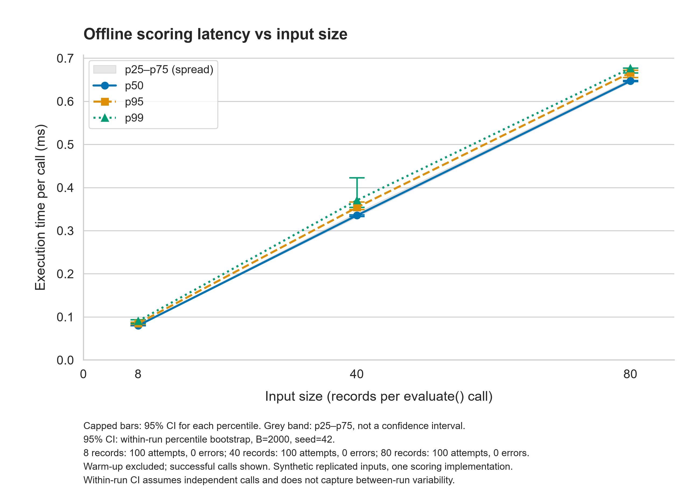
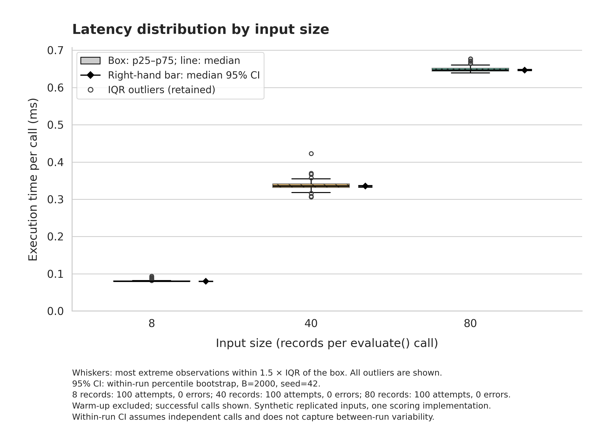

# Integration of AI Tools into the Inclusive Ecosystem of a Modern University: Barriers and Opportunities for Students with Visual and Hearing Impairments


[](LICENSE)

**Authors:** Bissenbai Zhalgas, Zhussip Nurdaulet  
**Repository:** [ZhalgasB/inclusive-ai-university](https://github.com/ZhalgasB/inclusive-ai-university)

## Project Overview and Research Aim

This project investigates barriers and opportunities associated with AI tools in inclusive university education. The planned study combines a qualitative review of published research with a quantitative pilot comparing manually prepared and AI-generated educational content.

The pilot focuses on two tasks: audio transcription relevant to students with hearing impairments, and image descriptions relevant to students with visual impairments. These tasks assess content fidelity; they do not by themselves establish overall accessibility, usability, or learning outcomes.

**Research question:** How accurately do unedited AI outputs preserve key information in educational audio and images compared with a manual baseline?

For each task, evaluated separately:

- **H0:** The mean key-fact preservation score of AI outputs is equal to or higher than that of manual outputs.
- **H1:** The mean key-fact preservation score of AI outputs is lower than that of manual outputs.

The independent variable is the preparation method: manual or AI without human correction. Both conditions use the same materials and reference facts. Reference annotations are established separately from the manual baseline, which may also contain errors.

**Current implementation:** an offline scoring pipeline for saved outputs and human annotations. It does not call an AI service or automatically judge whether a fact is correct. The included eight records are entirely synthetic, including their preparation times. They demonstrate that the pipeline works and cannot support conclusions about the hypotheses.

## Repository Structure

Key project files:

```text
inclusive-ai-university/
├── configs/
│   ├── config.json
│   ├── collector.yaml
│   └── load.yaml
├── data/
│   ├── sample/
│   │   ├── annotations.jsonl
│   │   └── DATA_GUIDE.txt
│   ├── raw/
│   │   ├── test_run.jsonl
│   │   └── load_run.jsonl
│   └── processed/
│       ├── measurements.csv
│       └── metrics_summary.csv
├── docs/
│   └── domain_model.md
├── notebooks/
│   └── 01_data_analysis.ipynb
├── reports/
│   └── figures/
│       ├── fig1_latency_vs_load.pdf
│       ├── fig1_latency_vs_load.png
│       ├── fig2_distribution_boxplot.pdf
│       └── fig2_distribution_boxplot.png
├── results/
│   ├── item_metrics.csv
│   ├── summary.csv
│   └── run_metadata.json
├── src/
│   ├── benchmark.py
│   ├── collector.py
│   ├── collect_load.py
│   ├── process_data.py
│   ├── visualize.py
│   └── inspect_annotations.py
├── tests/
│   ├── test_benchmark.py
│   ├── test_collector.py
│   ├── test_collect_load.py
│   ├── test_process_data.py
│   ├── test_statistics.py
│   └── test_visualize.py
├── .dockerignore
├── .gitignore
├── Dockerfile
├── LICENSE
├── README.md
└── requirements.txt
```

`results/` contains content-scoring outputs. `data/processed/` contains runtime analysis.
The original eight annotations and their supplied preparation times are synthetic; JSONL execution durations are actual measurements of the offline evaluator.

| Component | Responsibility |
| --- | --- |
| `benchmark.py` | Validate paired annotations and calculate Q, WER and content guardrails. |
| `collector.py` | Time complete evaluator calls, separate warm-up, retain execution errors and write JSONL. |
| `collect_load.py` | Construct paired synthetic workloads of 8/40/80 records and reuse the collector. |
| `process_data.py` | Validate logs, retain failures/outliers, calculate statistics and bootstrap CI, export CSV. |
| `visualize.py` | Check CSV consistency and export two accessible figures in PDF and PNG. |
| `inspect_annotations.py` | Inspect the annotation fixture and its content-related guardrails. |
| `01_data_analysis.ipynb` | Execute the saved-log analysis from start to finish with visible tables and figures. |

## System Requirements

- Docker Desktop on macOS, with Docker running; Git for cloning.
- CPU execution; no GPU, CUDA, AI API key or host Python installation is required.
- Internet for cloning and the first image build. Saved-log analysis runs offline afterward.

The image provides Python 3.12.15, JupyterLab 4.4.9, Pandas, NumPy, Matplotlib and Seaborn. The base image is pinned by digest; Python packages are pinned with exact versions and hashes. Seaborn is fixed at 0.13.2.

The recorded load collection used one CPU quota and a 1 GiB memory limit. These limits improve consistency but do not reserve a physical CPU or eliminate macOS/VM background noise.

## Quickstart: Reproduce Task 3 Analysis in Three Commands

Run all three commands from the same parent directory, before entering the cloned repository:

```bash
git clone https://github.com/ZhalgasB/inclusive-ai-university.git
docker build -t inclusive-ai-university ./inclusive-ai-university
docker run --rm -v "$(pwd)/inclusive-ai-university:/app" inclusive-ai-university jupyter nbconvert --to notebook --execute --inplace --ExecutePreprocessor.timeout=120 notebooks/01_data_analysis.ipynb
```

This reanalyzes the committed `data/raw/load_run.jsonl`, updates both processed CSV files, exports four figure files and saves the Notebook with executed outputs. It does not collect new timings. Expected results: **330 raw records, 30 warm-up records excluded, 300 working measurements, three summary rows, and seven code cells executed in order**. The last Notebook cell reports `All checks passed`.

The bind mount saves outputs back to the Mac. Subsequent commands below assume the **repository root** as the working directory.

## Individual Pipeline Commands

Score the original synthetic annotation fixture:

```bash
docker run --rm -v "$(pwd):/app" inclusive-ai-university python src/benchmark.py --config configs/config.json
```

Reproduce the timing statistics and figures from saved logs:

```bash
docker run --rm -v "$(pwd):/app" inclusive-ai-university python src/process_data.py --input data/raw/load_run.jsonl
docker run --rm -v "$(pwd):/app" inclusive-ai-university python src/visualize.py
```

The processor preserves the raw log and overwrites the generated CSV files. The visualizer overwrites the generated figures. Always process `load_run.jsonl` for the three-load plots; the earlier `test_run.jsonl` contains repeated runs at only eight records.

### Collect a new timing experiment

The committed log is preserved. Use a new filename for a new run, for example:

```bash
docker run --rm --cpus="1.0" --memory="1g" --memory-swap="1g" -v "$(pwd):/app" inclusive-ai-university python src/collect_load.py --config configs/load.yaml --log-path data/raw/load_run_02.jsonl
docker run --rm -v "$(pwd):/app" inclusive-ai-university python src/process_data.py --input data/raw/load_run_02.jsonl
docker run --rm -v "$(pwd):/app" inclusive-ai-university python src/visualize.py
```

Choose another unused filename on further runs; the load collector refuses to overwrite an existing journal. To analyze the new log in the Notebook, update `log_path` in `configs/load.yaml`. New timing values will differ; the tables below describe the committed original run. Only the two explicitly allowlisted small sample logs are tracked by Git.

## Evaluation Metrics


Human annotators assign one score, `0` or `1`, to each reference fact. A score of `1` means that the output preserves that fact correctly.

| Role | Metric | Definition |
| --- | --- | --- |
| Primary | Key-fact preservation, Q (%) | `100 × correctly preserved facts / total reference facts`, calculated per material and then averaged within each task and condition. Failed attempts receive Q = 0. |
| Secondary | Word Error Rate, WER (%) | `100 × (substitutions + deletions + insertions) / reference words`; calculated only for audio transcripts. |
| Secondary | Preparation time (seconds) | Median recorded end-to-end preparation time across successful attempts. |
| Guardrail | Critical-error rate (%) | `100 × outputs flagged as critically misleading / all attempts`; configured limit: 0%. |
| Guardrail | Failure rate (%) | `100 × failed attempts / all attempts`; configured limit: 0%. |

Group WER pools word-error counts and reference-word counts across successful audio attempts. Both reference and output are casefolded, and punctuation is discarded. WER can exceed 100% because of insertions. WER is left empty for images and failed attempts; the failure rate must be inspected alongside it.

Preparation times and critical-error flags are supplied in the annotations. The script does not measure AI response latency. Failed attempts remain in the quality and guardrail denominators, but are excluded from successful-output timing and WER. Passing the guardrails is a descriptive check on the evaluated sample, not an accessibility certification.

See [the data guide](data/sample/DATA_GUIDE.txt) for the input fields, annotation rules and handling of failures.

## Results & Discussion

### Measured offline execution times under synthetic input loads

The independent variable is **records per evaluator call**, not requests per second. Larger workloads replicate the eight-record fixture with unique IDs while preserving manual/AI pairs. Replication happens before timing. Each complete `evaluate()` call includes validation and scoring; input parsing, logging and printing are outside its measured interval.

Each input size has 10 warm-up calls and 100 working calls. The order is shuffled with seed 42. Statistics are calculated separately for each run and input size. Warm-up is excluded; successful IQR outliers are retained. Failure rate uses all working attempts.

Source: [metrics_summary.csv](data/processed/metrics_summary.csv). Values below are rounded; SD is the sample standard deviation (`ddof=1`). Timing statistics describe successful calls.

| Input records / call | Attempts | Mean ± SD (ms) | Median (p25–p75), ms | p95 (ms) | p99 (ms) | Execution failures (%) |
| ---: | ---: | ---: | ---: | ---: | ---: | ---: |
| 8 | 100 | 0.080749 ± 0.002326 | 0.079917 (0.079667–0.080562) | 0.084890 | 0.090283 | 0.0 |
| 40 | 100 | 0.337364 ± 0.013318 | 0.335417 (0.331625–0.341448) | 0.353972 | 0.370444 | 0.0 |
| 80 | 100 | 0.648870 ± 0.007790 | 0.646979 (0.644094–0.651416) | 0.666375 | 0.676840 | 0.0 |

Median batch time increased from approximately 0.080 ms at eight records to 0.647 ms at 80 records in these runs. This is a descriptive result for one scoring implementation. The three input sizes are workload conditions, not competing algorithms, AI response latencies, or independent research materials. The eight-record workload is not the manual research baseline.

The summary also contains 95% percentile-bootstrap intervals for mean, p50, p95, p99 and compute goodput (2,000 resamples, seed 42). Latency CI conditions on successful calls. Goodput divides successful calls by the measured function time of all attempts, including failures; it is not server RPS. CI assumes IID calls within a run. One run per size does not capture variability between independent runs or machines, and p99 is exploratory with 100 calls.

### Scientific figures



**Figure 1.** Successful-call p50/p95/p99 versus records per call. Capped bars show their 95% within-run bootstrap CI; the grey band shows p25–p75 of individual durations. The measured times rise across the three input sizes. Warm-up is excluded. Every size has 100 working attempts and zero observed execution errors. [Vector PDF](reports/figures/fig1_latency_vs_load.pdf).



**Figure 2.** Timing distributions for 8, 40 and 80 records per call. Boxes span p25–p75; the internal line marks the median. Whiskers reach the most extreme observations within 1.5 × IQR of the box. Circles show retained outliers. Separate right-hand bars show median 95% bootstrap CI. These are input-volume conditions of the same evaluator. [Vector PDF](reports/figures/fig2_distribution_boxplot.pdf).

Both figures use milliseconds, a zero-based latency scale, colorblind-safe colors and redundant markers/line styles or hatches. PNG exports are 300 DPI; PDFs are vector. Full assumptions and error counts are included in the figure captions.

### Baseline versus proposed condition: synthetic fixture demonstration only

**This table contains invented annotation data, not results of a completed manual-versus-AI study.** “Baseline” and “proposed condition” identify the intended research roles. The fixture merely checks that the evaluator can compare those groups. Q is shown as Mean ± sample SD across all attempts, including failed outputs with Q = 0; with only two synthetic attempts per group, the spread has no evidential value about real AI quality.

| Task | Condition / intended role | Attempts | Q: Mean ± SD (%) | Pooled WER (%) | Critical errors (%) | Output failures (%) |
| --- | --- | ---: | ---: | ---: | ---: | ---: |
| Audio | Manual — baseline fixture | 2 | 100.00 ± 0.00 | 5.88 | 0 | 0 |
| Audio | AI — proposed-condition fixture | 2 | 75.00 ± 35.36 | 5.88 | 50 | 0 |
| Image | Manual — baseline fixture | 2 | 83.33 ± 23.57 | N/A | 0 | 0 |
| Image | AI — proposed-condition fixture | 2 | 25.00 ± 35.36 | N/A | 0 | 50 |

Sources: [per-output scores](results/item_metrics.csv) and [grouped quality metrics](results/summary.csv). WER is defined only for successful audio outputs. The fixture deliberately includes a critical content error and a failed output. Content failures and execution exceptions in the timing log are different events.

The synthetic comparison does not confirm or reject H0/H1. A real research comparison requires collected source materials, manual and AI outputs, independent references and recorded preparation times. No significance test is implemented in the current scorer.

## Domain Model and Executed Notebook

- [Domain model and metric formulas](docs/domain_model.md): entities, data flow, notation, Q/WER, runtime quantiles, bootstrap CI, IQR and guardrails.
- [Executed analysis Notebook](notebooks/01_data_analysis.ipynb): ingestion, warm-up filtering, guardrails, statistics, exported plots, discussion and checks, with saved outputs.

The Notebook imports the same modules as the CLI. It identifies the raw log by SHA-256 and verifies that it remains unchanged. Keep cell outputs in the submitted Notebook.

## Planned Research Benchmarks


| Task | Planned materials shared by both conditions | Baseline | Experimental condition | Main evaluation |
| --- | --- | --- | --- | --- |
| Audio transcription | 10 short educational audio clips | Manual transcription without AI | Saved, unedited AI transcription | Q, WER, preparation time, critical errors and failures |
| Image description | 10 educational images | Manual description without AI | Saved, unedited AI description | Q, preparation time, critical errors and failures |

This plan corresponds to 20 unique materials and 40 outputs or failed attempts. Collection has not yet been reported in this repository. The implemented script produces descriptive metrics; it does not perform a statistical hypothesis test.

For the real pilot, preserve the source materials, reference facts, human annotations, raw outputs, prompts, model identifier/version, collection date and measured preparation times. Use the same inputs and scoring rules for both conditions, define timing boundaries and critical-error criteria before collection, and retain failed attempts. Point `config.json` to the real dataset and change `dataset_type` to `research` only when actual study data are used.

## Tests and Reproducibility

From the repository root:

```bash
docker run --rm -v "$(pwd):/app" inclusive-ai-university python -m unittest discover -s tests -v
```

Expected result for the current version: **44 tests pass with `OK`**. Coverage includes annotation validation and scoring, timing boundaries, warm-up exclusion, execution failures, paired workload construction, CSV consistency, bootstrap repeatability, retained outliers and PDF/300-DPI PNG export.

The scoring fixture is deterministic. `PYTHONHASHSEED=42` is set in Docker; the load order and analysis bootstrap use explicit seeds. Identical saved inputs reproduce numerical tables in the pinned environment. New benchmark runs will have different durations, IDs and timestamps; recreated PDFs may also have different file metadata.

`.gitignore` excludes environments, caches, Jupyter checkpoints, secrets, model weights and unapproved raw logs. The small sample logs, processed tables, executed Notebook and publication figures are intentional research artifacts.

## Optional: Interactive JupyterLab

After building the image, from the repository root:

```bash
docker run --rm -it -p 127.0.0.1:8888:8888 -v "$(pwd):/app" inclusive-ai-university
```

Open the token-protected URL printed in the terminal. Open `notebooks/01_data_analysis.ipynb`, select **Restart Kernel and Run All Cells**, then save it with outputs. The terminal must remain open while using JupyterLab.

## Citation


```bibtex
@misc{inclusiveai2026,
  author       = {{Bissenbai Zhalgas} and {Zhussip Nurdaulet}},
  title        = {Integration of AI Tools into the Inclusive Ecosystem of a Modern University: Barriers and Opportunities for Students with Visual and Hearing Impairments},
  year         = {2026},
  howpublished = {GitHub repository},
  url          = {https://github.com/ZhalgasB/inclusive-ai-university}
}
```

## License

The project code and synthetic sample are distributed under the [MIT License](LICENSE). Third-party publications, source materials and model outputs remain subject to their applicable licenses and terms.
