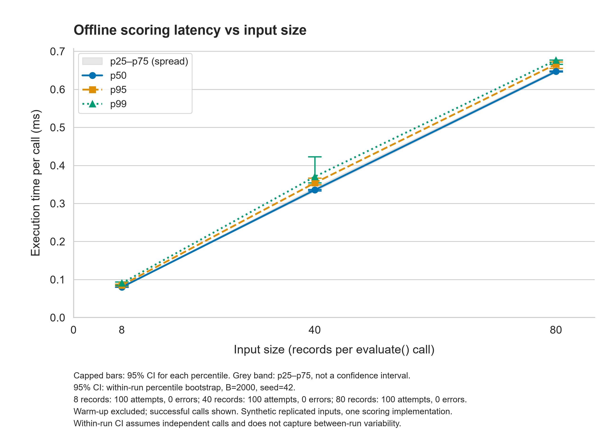
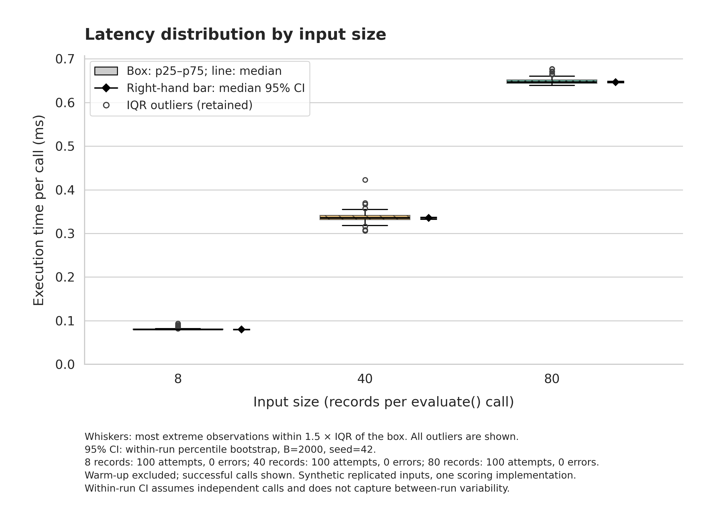

# TASK 3 — Research Results, Data Analysis and Scientific Visualization

**Project:** Integration of AI Tools into the Inclusive Ecosystem of a Modern University: Barriers and Opportunities for Students with Visual and Hearing Impairments  
**Authors:** Bissenbai Zhalgas, Zhussip Nurdaulet  
**Repository:** https://github.com/ZhalgasB/inclusive-ai-university  
**Report date:** 3 November 2026  
**Code/data revision audited:** [4d9239c](https://github.com/ZhalgasB/inclusive-ai-university/commit/4d9239c71f97be4436898a93bc953d90f32cdef7).

## 4. Experiment Results & Discussion

### 4.1 Aim and scope of the completed experiment

The broader project concerns educational audio transcription and image descriptions for an inclusive university environment. Its planned research comparison is manual preparation without AI versus unedited AI output, evaluated against separately prepared reference facts.

The completed experiment reported here measures **the execution time of the offline evaluation program**, not the time or quality of a live AI service. The technical question is: *How does the observed runtime of one complete `evaluate()` call change when its input batch grows from 8 to 40 and 80 annotation records?*

Input content is synthetic; the recorded execution durations are measured. The code validates annotations and computes content metrics. It neither trains a model nor automatically judges fact correctness. The current evidence does not confirm or reject the research H0/H1 about AI versus manual output quality.

### 4.2 Experimental setup and variable classification

| Role | Definition |
| --- | --- |
| Independent variable | Batch size: 8, 40 or 80 annotation records per evaluator call. |
| Dependent variables | Successful-call mean, sample SD, median, p95 and p99 in milliseconds; execution-failure rate; compute goodput. |
| Fixed conditions | Same evaluator, source fixture, scoring rules and Docker configuration; 10 warm-up calls and 100 working calls per size. |
| Recorded resource limits | `--cpus="1.0" --memory="1g" --memory-swap="1g"` on Docker running on macOS. |
| Randomness | Load-order seed 42; bootstrap seed 42 and 2,000 resamples. |

The 40- and 80-record workloads repeat the eight-record fixture five and ten times, assigning unique identifiers while retaining manual/AI pairs. Copies are not new independent research materials. Input construction and reading happen before timing. The `perf_counter_ns()` measurement surrounds the evaluator call, including its validation and calculations. File writing, printing and exception-message formatting occur outside that interval.

One run was collected for each size. CPU quotas and memory limits constrain the container but do not eliminate host activity, cache effects or temporal drift. The log does not contain a complete hardware inventory, so portability of the measured values to other machines is not asserted.

### 4.3 Data processing and mathematical definitions

The raw journal contains **330 records: 30 warm-up and 300 working measurements**. Warm-up is excluded from statistical analysis. Measured execution failures remain in the dataset and guardrail denominator. Outliers are flagged separately within each run and workload using the IQR rule and are retained in the statistics and figures. The observed flag counts were 13, 8 and 8 for 8, 40 and 80 records, respectively.

For working call $r$ at input size $b$:

$$
t_{b,r}=\frac{T_{b,r}^{end}-T_{b,r}^{start}}{10^6}\ \mathrm{ms}.
$$

Let $n_b$ be all working attempts, $S_b$ the successful attempts and $m_b=|S_b|$. Then:

$$
\bar t_b=\frac{1}{m_b}\sum_{r\in S_b}t_{b,r},\qquad
s_b=\sqrt{\frac{\sum_{r\in S_b}(t_{b,r}-\bar t_b)^2}{m_b-1}},\qquad
F_b=100\frac{n_b-m_b}{n_b}.
$$

SD uses `ddof=1`. The reported median, p95 and p99 use linear-interpolated quantiles of successful durations. The processor also exports the mean over all outcomes. An undefined statistic remains empty rather than becoming zero.

For statistic $\theta$, its percentile-bootstrap interval is:

$$
\mathrm{CI}_{95\%}(\theta)=\left[q_{0.025}(\theta^*),q_{0.975}(\theta^*)\right],
$$

where $\theta^*$ contains statistics from 2,000 samples drawn with replacement. Latency intervals condition on successful calls. They assume IID observations within a run; they do not estimate variation between independent runs or machines. The p25–p75 interval describes spread of individual durations, not uncertainty in a statistic.

The original research metric is key-fact preservation:

$$
Q_i=100\frac{\sum_{j=1}^{f_i}a_{ij}}{f_i},\qquad a_{ij}\in\{0,1\},
$$

where $f_i$ is the number of reference facts and $a_{ij}$ is a human annotation. Failed outputs receive $Q_i=0$. Q is averaged across all attempts within a task and condition. Full notation, WER, guardrails and data flow are defined in [the domain model](../docs/domain_model.md).

**Data provenance:** `data/raw/load_run.jsonl`  
**SHA-256:** `8719c73cb2e24a53c752227842f13c850bdea342469cfe117bdd385544326efd`

### 4.4 Runtime results

**Table 1.** Successful-call timings for the same evaluator under three input volumes. All values are milliseconds except batch size, counts and percentages. No measured execution errors occurred; this describes the observed sample, not a general guarantee of failure-free execution.

| Records / call | Attempts | Mean ± SD (ms) | Median (p25–p75), ms | p95 (ms) | p99 (ms) | Execution failures (%) |
| ---: | ---: | ---: | ---: | ---: | ---: | ---: |
| 8 | 100 | 0.080749 ± 0.002326 | 0.079917 (0.079667–0.080562) | 0.084890 | 0.090283 | 0.0 |
| 40 | 100 | 0.337364 ± 0.013318 | 0.335417 (0.331625–0.341448) | 0.353972 | 0.370444 | 0.0 |
| 80 | 100 | 0.648870 ± 0.007790 | 0.646979 (0.644094–0.651416) | 0.666375 | 0.676840 | 0.0 |

**Table 2.** 95% within-run percentile-bootstrap intervals, in milliseconds.

| Records / call | Median 95% CI | p95 95% CI | p99 95% CI |
| ---: | ---: | ---: | ---: |
| 8 | [0.079833, 0.080021] | [0.082890, 0.088112] | [0.084906, 0.093500] |
| 40 | [0.333291, 0.337065] | [0.349491, 0.366987] | [0.354076, 0.422625] |
| 80 | [0.646146, 0.648813] | [0.655125, 0.671925] | [0.666212, 0.677500] |

Median batch runtime increased from approximately 0.080 ms to 0.647 ms between the smallest and largest workloads: 10× as many records corresponded to approximately 8.10× the median runtime in these observations. Three sizes and one run per size are insufficient to establish an asymptotic complexity law or a general scaling guarantee.

The relatively wide p99 interval for 40 records reflects uncertainty in the sparsely sampled tail. Retaining unusual durations avoids reporting an artificially cleaned latency distribution.

### 4.5 Scientific figures



**Figure 1.** p50, p95 and p99 of successful evaluator calls versus records per call. Capped bars show 95% within-run bootstrap CI; the grey band shows p25–p75. The observed timings increase with input volume. Each size has 100 working attempts and zero observed execution exceptions; warm-up is excluded. Colorblind-safe colors, distinct markers and line styles support accessible reading. [Vector PDF](figures/fig1_latency_vs_load.pdf).



**Figure 2.** Successful-call distributions for 8, 40 and 80 records. Boxes span p25–p75; internal lines mark medians. Whiskers reach the most extreme observations within 1.5 × IQR of the box. Circles are retained outliers. Separate right-hand markers and bars show medians and 95% bootstrap CI. The groups compare input volumes of one implementation, not manual and AI methods. [Vector PDF](figures/fig2_distribution_boxplot.pdf).

Both figures have explicit units and zero-based latency scales. PNG files are 2580 × 1860 pixels with 300-DPI metadata; PDFs contain vector graphics. The IQR band and bootstrap CI are separately identified in their captions.

### 4.6 Baseline versus proposed condition: demonstration status

**The following comparison is a software-validation fixture, not a completed research result.** The baseline role is manual preparation; the proposed condition is unedited AI output. All eight annotation records, including their supplied preparation times, are invented. No observations about real AI effectiveness can be inferred from this table.

| Task | Condition / intended role | Attempts | Q: Mean ± SD (%) | Pooled WER (%) | Critical errors (%) | Output failures (%) |
| --- | --- | ---: | ---: | ---: | ---: | ---: |
| Audio | Manual — baseline fixture | 2 | 100.00 ± 0.00 | 5.88 | 0 | 0 |
| Audio | AI — proposed-condition fixture | 2 | 75.00 ± 35.36 | 5.88 | 50 | 0 |
| Image | Manual — baseline fixture | 2 | 83.33 ± 23.57 | N/A | 0 | 0 |
| Image | AI — proposed-condition fixture | 2 | 25.00 ± 35.36 | N/A | 0 | 50 |

Q is Mean ± sample SD, including failed outputs with zero scores. WER pools word-edit counts across successful audio outputs. Each group contains only two synthetic attempts. A content-output failure and an exception during execution of the scorer are different events.

A genuine Baseline/Proposed research comparison remains outstanding. The planned pilot uses ten audio clips and ten images, each processed under both preparation conditions, with independent references and retained failures. The load sizes in Table 1 cannot substitute for that comparison. Submission of only the technical benchmark as the final research scope requires agreement with the course instructor.

### 4.7 Reproducibility and validation

The repository separates source code, configurations, sample/raw/processed data, figures and the executed Notebook. The image pins Python 3.12.15 through its base-image digest; Python package versions and hashes are fixed in `requirements.txt`.

The analysis Notebook has seven code cells executed in order, saved tables, two embedded figures and a final `All checks passed` output. The prepared submission removes nonstandard `jetTransient` output fields while preserving these results. The domain model belongs at `docs/domain_model.md` so its relative links resolve correctly.

During the final audit, **44 automated tests passed** on an isolated checkout of the cited code revision. Tests cover scoring, validation, warm-up, error retention, workload pairing, bootstrap repeatability, data consistency and figure export. This audit used a local Python verification environment; a fresh Docker image build was not repeated during the audit.

From the repository root, after building the Docker image:

```bash
docker run --rm -v "$(pwd):/app" inclusive-ai-university python -m unittest discover -s tests -v
docker run --rm -v "$(pwd):/app" inclusive-ai-university jupyter nbconvert --to notebook --execute --inplace --ExecutePreprocessor.timeout=120 notebooks/01_data_analysis.ipynb
```

The Notebook regenerates statistics and figures from saved logs. Its SHA-256 check confirms that the raw source remains unchanged. Numerical results can be reproduced from the same saved data and pinned environment. Newly measured timings will vary; regenerated PDF metadata can also differ.

### 4.8 Limitations and conclusion

The completed technical experiment demonstrates an executable measurement, analysis and visualization workflow. Within the recorded runs, larger batches required longer evaluation times, while all 300 working evaluator calls completed without execution exceptions.

Limitations include synthetic repeated content, one run per size, possible correlation between sequential calls, sensitivity of p99 to a small tail sample, incomplete hardware metadata, and absence of a real manual-versus-AI comparison. The results do not establish accessibility, usability, student learning outcomes or superiority of either preparation method. Those claims require the planned research data and additional evaluation.
